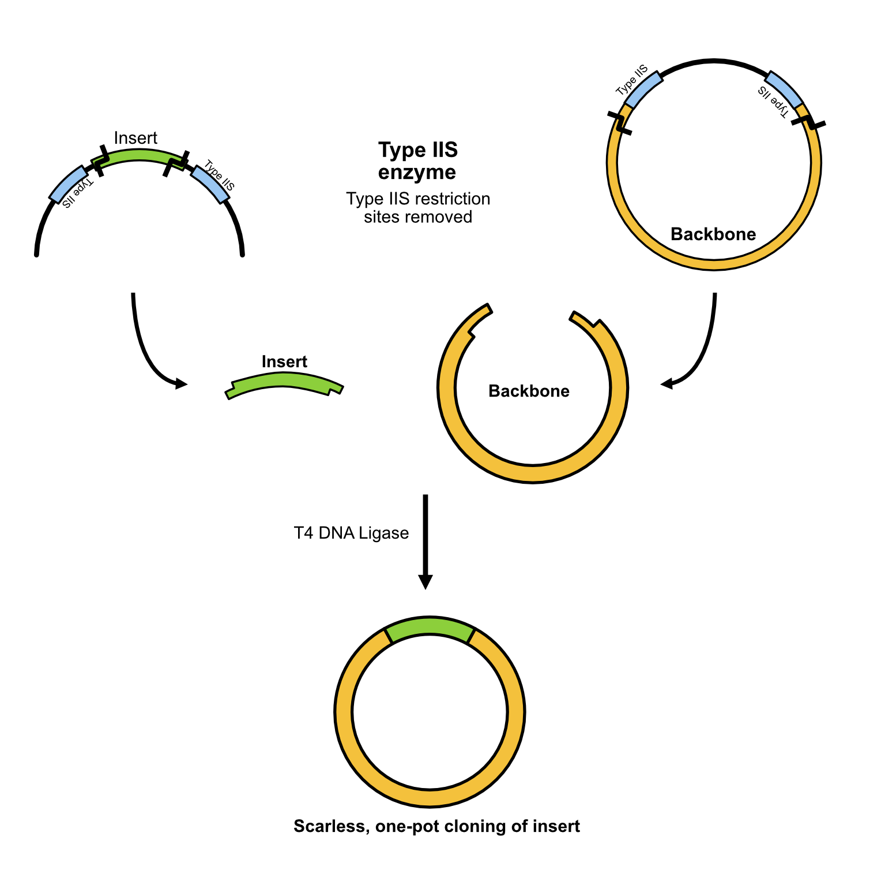

# Golden Gate Assembly

Traditional [**restriction/ligation**](/units/glossary.md#restrictionligation) cloning using type II enzymes and a T4 ligase is useful for joining one or two inserts into vector. This requires *multiple* restriction enzymes, each with a different recognition sequence. Since the pool of palindromic sequences between 5 and 6 nucleotides in length is limited, increasing the number of inserts becomes very difficult. This is why we turn to type IIS restriction enzymes for multi-insert cloning.

Recall in the section on [restriction enzymes](/units/cloning/restriction-ligation.md#restriction-enzymes), type IIS restriction enzymes do not cut at their cognate recognition sequence, but instead cut asymmetrically. This leaves a sticky-end of *any* nucleotide sequence `NNNN`. If designed correctly, the sequences of overhanging DNA in each of your fragments will complement with each other, allowing for [**annealing**](/units/glossary.md#annealing) and subsequent ligation with T4 ligase. This technique was originally published in 2008, under the name [Golden Gate](https://journals.plos.org/plosone/article?id=10.1371/journal.pone.0003647).

Although it requires some very precise design, one can design a vector that has a self-excising type IIS restriction site that matches directly with the overhangs left from the type IIS site on the fragments you want to insert. Since the overhangs can be any sequence of `NNNN`, one can theoretically ligate up to 128 fragments simultaneously in one reaction. In reality, though, Golden Gate is rarely used to ligate more than 7 fragments due to mismatches during annealing.

## Protocol: Golden Gate Assembly

### [One-Pot Assembly Reaction](/protocols/golden_gate.md)

### [Bacterial Transformation](/protocols/chemical_transformation_of_e_coli.md)
