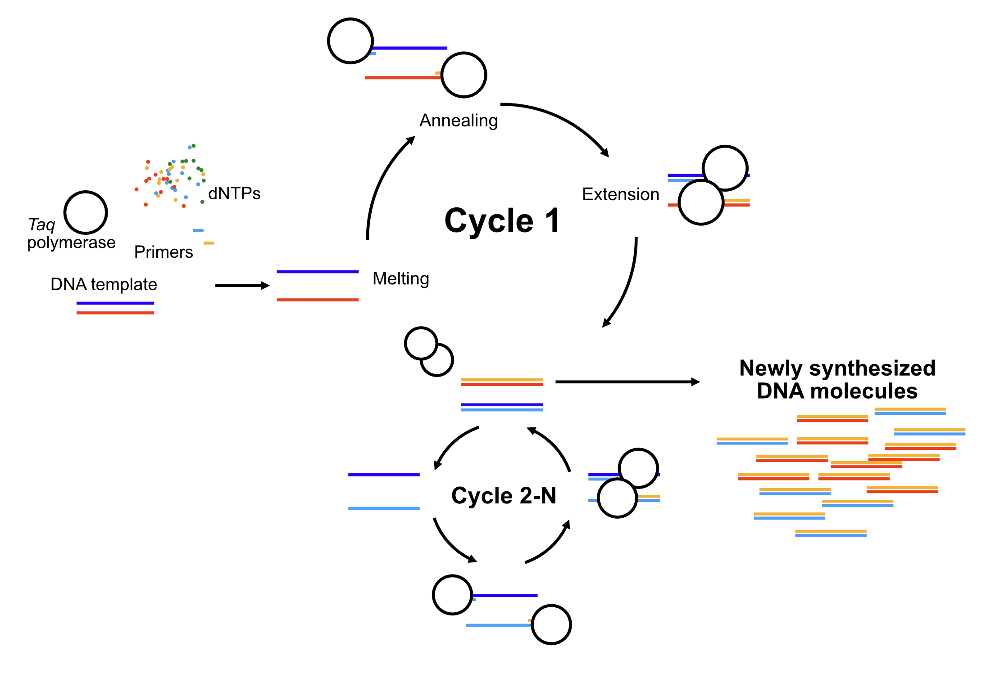

# Polymerase Chain Reaction (PCR)

Polymerase chain reaction (PCR) is an indispensable technique in the tool belt of a biologist. At its core, PCR copies a DNA sequence using a template, a DNA polymerase, single-stranded DNA primers, and deoxynucleotide triphosphates:

- Template DNA: a DNA molecule containing the sequence to be copied
- Thermostable DNA polymerase: a variant of DNA polymerase from a thermophilic bacterium (originally *Thermus aquaticus*, but variants from other species are also used).
- Single-stranded DNA primers: short [**oligonucleotides**](/units/glossary.md#oligonucleotide) that are complementary to strands of the template DNA, often referred to as *forward* and *reverse* primers, indicating the direction in which they prime the polymerase to synthesize
- Deoxynucleotide triphosphates (dNTPs): The building blocks of DNA. They are the substrate for DNA polymerase and will be chained together to form the complementary strand of DNA.

A typical PCR is composed of four main steps, each taking place at a different temperature:

1. Melting (95ºC): the template DNA to be copied is heated up until the hydrogen bonds holding the base pairs together are broken. This generates two complementary single-stranded DNA molecules.
2. Annealing (50-70ºC): the temperature of the reaction is lowered, allowing the single-stranded complementary primers to base pair with their complementary sequences on the DNA molecule. This "priming" allows the DNA polymerase to recognize the double-stranded DNA and associate with the duplex.
3. Extension (72ºC): The polymerase incorporates the dNTPs into the newly-formed molecule, generating the complementary strand of DNA.
4. Final extension (72ºC): An optional final step, which synthesizes any strands of DNA that were not fully synthesized by the end of the extension step. We can think of it as finishing off the DNA that still has single-stranded overhangs.

This cycle is repeated 20-40 times, each time doubling the number of individual DNA molecules in the reaction. These DNA molecules can then go on to generate two more copies, leading to an exponential growth in the number of DNA copies in the reaction. The limiting reagent is the amount of available dNTPs in the reaction mixture, which eventually are exhausted.

>I have intentionally left out the incubation times for each of these steps because it varies so widely between polymerases, templates, and reaction buffers. For example, polymerase synthesis rates range from 20-200 bases/s, which would require tuning the extension time considerably. Likewise, time spent annealing varies depending on the composition of the reaction buffer, the DNA polymerase used, and the composition of the primers. Heuristics can guide where to start, but the best way to determine reaction conditions is just to *start*.

