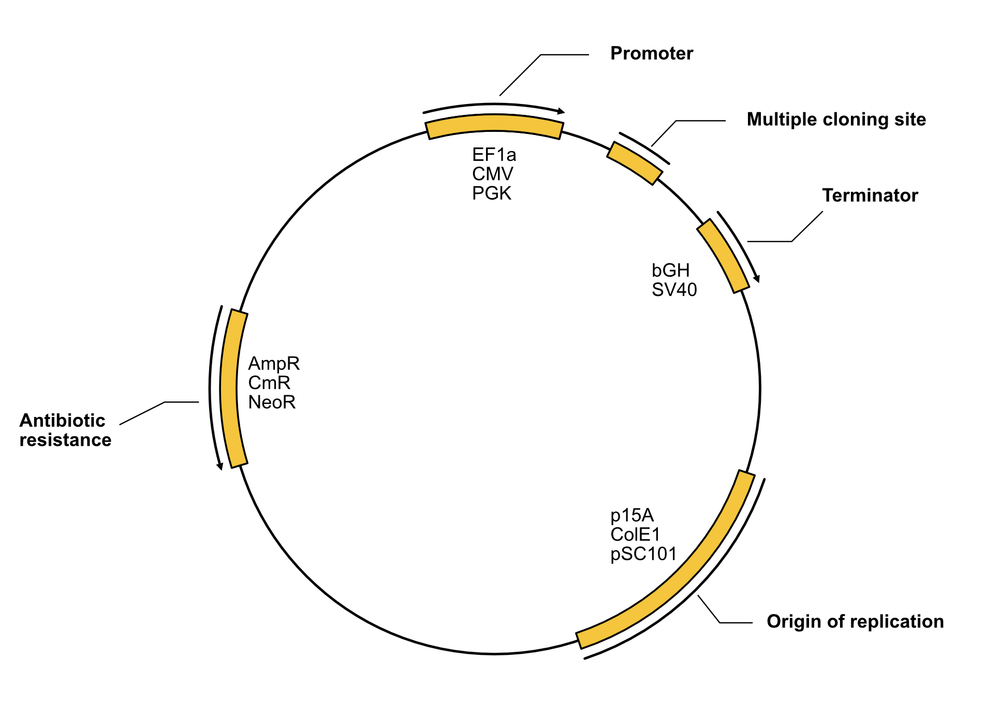

# DNA, Plasmids, and Vectors

A plasmid is a circular piece of DNA, with no start or end. Circular DNA is very stable, since it has no free 5’ or 3’-hydroxyl ends for [**nucleases**](/units/glossary.md#nuclease) to target. Plasmids were originally derived from bacteria, which harbor various kinds of plasmids encoding genes for reproduction, antibiotic resistance, and virulence. Humans can take advantage of plasmids as a vector for genetic alteration or introduction of a perturbation to an organism. Plasmids can vary widely, but those used for routine gene expression contain the following: 

- [**Origin of replication**](/units/glossary.md#origin-of-replication): the region of the plasmid that allows it to be propagated inside of a bacterium.

- [**Antibiotic resistance**](/units/glossary.md#antibiotic-resistance): a selection marker. Cells carrying this gene grow in the presence of an antibiotic, thus showing which cells are carrying the plasmid we want. Cells that are untransformed (not carrying the plasmid) die.

- [**Multiple cloning site (MCS)**](/units/glossary.md#multiple-cloning-site-mcs): The site where (in traditional restriction/ligation cloning) the gene of interest can be inserted. The MCS is usually sandwiched between the promoter and the terminator.

- [**Promoter**](/units/glossary.md#promoter): The region of the plasmid that recruits the transcription machinery in the target organism. Notably, this gene is not expressed in the bacterium.

- [**Terminator**](/units/glossary.md#terminator): The region of the plasmid that signals the transcription machinery to stop synthesizing mRNA. Usually coupled with a [**poly-adenylation**](/units/glossary.md#poly-adenylation) (polyA) signal.

Because a plasmid is circular and double stranded and thus a palindrome, the features encoded in this DNA have a pre-defined direction based on the biochemistry of transcription and replication. We read a sequence from 5' to 3', meaning the first base of the sequence is that which has a free 5'-OH group, and the end base has a free 3'-OH. An example of a plasmid is below, with the features marked in bold, the direction we read the feature as an arrow, and some examples of the sequences. Origins of replication and MCS are not usually annotated as having directionality.

## Figure 1 | A prototypical mammalian expression plasmid

A plasmid is a circular piece of DNA that contains genetic regions encoded in its nucleotide sequence. These are often called "feature" or "regions". A bare-bones mammalian expression plasmid usually has a [**promoter**](/units/glossary.md#promoter), a [**multiple cloning site**](/units/glossary.md#multiple-cloning-site-mcs), a [**terminator**](/units/glossary.md#terminator), an [**origin of replication**](/units/glossary.md#origin-of-replication), and an [**antibiotic resistance gene**](/units/glossary.md#antibiotic-resistance). Since the MCS is not occupied by a gene of interest, we call this a [**vector**](/units/glossary.md#vector), a [**backbone**](/units/glossary.md#backbone), or a [**parent plasmid**](/units/glossary.md#parent-plasmid).

