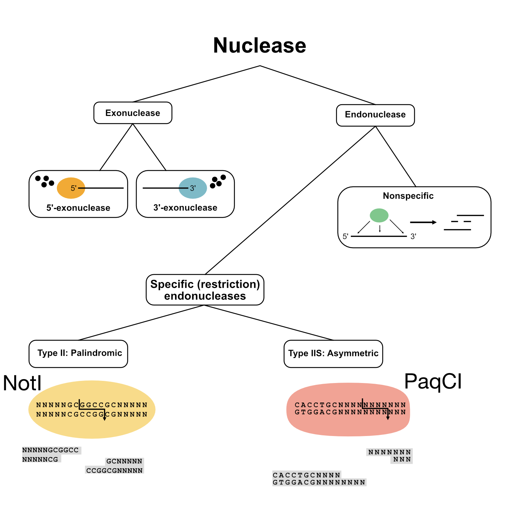
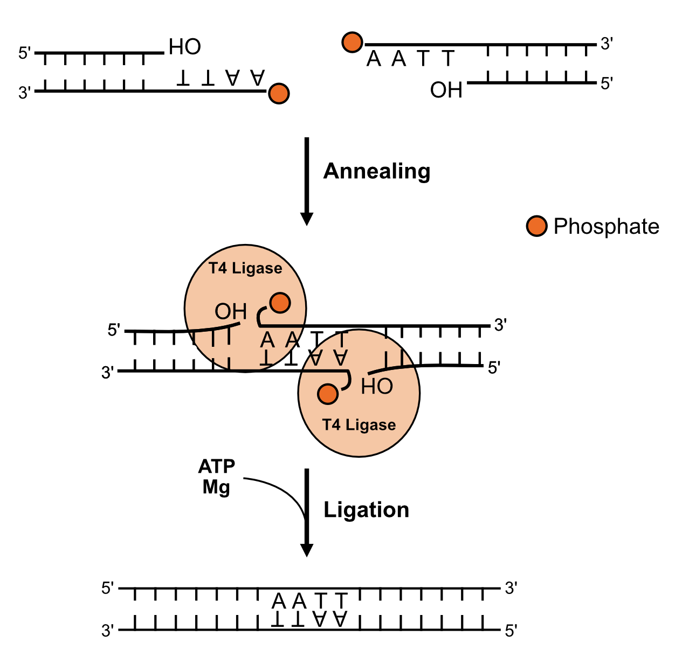

# Restriction/Ligation Cloning

## Restriction Enzymes

[**Nucleases**](/units/glossary.md#nuclease) are a class of enzyme that acts to break down nucleic acids (DNA, RNA, etc). DNases (DNA nucleases), come in two flavors: exonuclease and endonucleases. Exonucleases, like their name suggests, act to digest DNA from its terminal 5'-OH or 3'-OH ends and are highly efficient at degrading DNA. In contrast, endonucleases cut DNA from inside and can be [**nonspecific**](/units/glossary.md#nonspecific) or cut only at a recognized sequence (restriction endonucleases).

Type II and type IIS restriction enzymes are commonly used in molecular cloning due to their ability to recognize and cut at specific sequences of DNA. Type II enzymes recognize palindromic sequences of DNA and cut, leaving either sticky (ends with single-stranded overhangs) or blunt (coherent base paired) ends. Type IIS enzymes recognize a specific sequence, but do not cleave it. Instead, they cut specific sequences downstream, leaving sticky ends that can be any sequence.

Like everything in biology, restriction enzymes are not perfect. Oftentimes, there is a [**consensus**](/units/glossary.md#consensus) sequence where enzymes cut, but this sequence is not always strictly obeyed. Therefore, enzymes exhibit [**star activity**](/units/glossary.md#star-activity), or off-target cutting. An example of this is the restriction enzyme BamHI, where the most common cutting sequence is `G|GATCC` but depending on salt concentration and pH, it can cut at other sites.

## DNA Ligation

As you may have recognized, when using the correct restriction enzymes on both your backbone and your insert, you will have palindromic sequences that can base pair. This is the main reason we use Type II restriction enzymes: to guide assembly of two or more pieces of DNA based on their end homology. Restriction digests can give us these pieces of DNA, but we use DNA ligation to stitch them together.

The most common form of DNA ligase used in the lab is T4 DNA ligase, an enzyme that catalyzes the formation of a [**phosphodiester**](/units/glossary.md#phosphodiester) bond between a 5'-phosphate and an adjacent 3'-OH group. T4 ligase uses ATP to catalyze the reaction to join two DNA molecules with homology.

## Protocols: Restriction Enzyme Cloning

### [PCR Amplification of Insert](/protocols/pcr.md)

### [Restriction Digest](/protocols/restriction_digest.md)

### Gel Extraction & Cleanup

PCR and restriction digest cleanup: e.g. Zymo Research's [DNA Clean & Concentrate Kit](https://www.zymoresearch.com/products/dna-clean-concentrator-5)

Gel purification: e.g. NEB's [Monarch DNA Gel Extraction Kit](https://www.neb.com/en-us/products/t1020-monarch-dna-gel-extraction-kit)

### [Ligation Reaction](/protocols/t4_ligase.md)

### [Bacterial Transformation](/protocols/chemical_transformation_of_e_coli.md)
